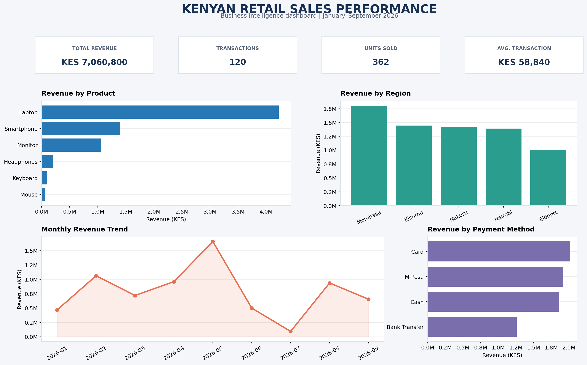

# SQL Business Sales Analysis

A practical SQL and data analytics portfolio project analyzing synthetic Kenyan retail sales data using **Python, SQLite, and SQL**. The project demonstrates how raw transaction data can be transformed into business insights to support sales performance monitoring and decision-making.

## Sales Performance Dashboard

The dashboard summarizes the main business performance indicators and visualizes revenue by product, region, month, and payment method.



## Project Objectives

- Analyze overall sales performance using SQL.
- Identify the products generating the most revenue.
- Compare revenue across regions.
- Examine monthly sales trends.
- Evaluate revenue by payment method.
- Generate actionable business insights from transaction data.
- Demonstrate a reproducible data analysis workflow for a professional portfolio.

## Technology Stack

- **SQL:** Data querying, aggregation, grouping, sorting, and business analysis.
- **SQLite:** Relational database storage and querying.
- **Python:** Dataset generation, database creation, validation, and analysis execution.
- **CSV:** Raw transaction data.
- **Matplotlib:** Business performance dashboard visualization.
- **Git and GitHub:** Version control and project publishing.

## Dataset Overview

The project uses a synthetic retail sales dataset representing transactions across five Kenyan regions.

| Attribute | Description |
|---|---|
| Transactions | 120 |
| Total units sold | 362 |
| Total revenue | KES 7,060,800 |
| Regions | Nairobi, Mombasa, Kisumu, Nakuru, Eldoret |
| Products | Laptop, Smartphone, Keyboard, Mouse, Monitor, Headphones |
| Payment methods | M-Pesa, Card, Cash, Bank Transfer |
| Period | January–September 2026 |

**Note:** The dataset is synthetic and is intended for learning and portfolio demonstration. It does not represent verified sales from a real business.

## Repository Structure

```text
sql-business-sales-analysis/
├── data/
│   └── sales_data.csv
├── sql/
│   └── sales_analysis.sql
├── reports/
│   ├── business_insights.md
│   └── sales_dashboard.png
├── generate_data.py
├── build_database.py
├── verify_database.py
├── run_analysis.py
├── create_dashboard.py
├── requirements.txt
├── .gitignore
└── README.md
```

The generated SQLite database (`data/sales.db`) is created locally by the database build script and is excluded from version control.

## Getting Started

### 1. Clone the repository

```bash
git clone https://github.com/vincentokello770-arch/sql-business-sales-analysis.git
cd sql-business-sales-analysis
```

### 2. Install dependencies

Use Python 3 and install the required packages:

```bash
python -m pip install -r requirements.txt
```

The dashboard generator requires Matplotlib. If it is not included in `requirements.txt`, install it with:

```bash
python -m pip install matplotlib
```

### 3. Generate the dataset

```bash
python generate_data.py
```

### 4. Build the SQLite database

```bash
python build_database.py
```

### 5. Validate the database

```bash
python verify_database.py
```

### 6. Execute the SQL analysis

```bash
python run_analysis.py
```

The analysis script executes the project's SQL queries and displays their results.

### 7. Generate the dashboard

```bash
python create_dashboard.py
```

The dashboard image is saved to:

```text
reports/sales_dashboard.png
```

## Key Business Findings

### Overall performance

- **Total revenue:** KES 7,060,800
- **Transactions:** 120
- **Units sold:** 362
- **Average transaction value:** KES 58,840

### Product performance

Laptops generated the highest revenue at **KES 4,225,000**, approximately **59.84% of total revenue**. Smartphones generated KES 1,400,000, while monitors generated KES 1,062,000.

Mice recorded the highest unit sales, with 74 units sold. This illustrates why revenue and sales volume should be analyzed separately.

### Regional performance

Mombasa recorded the highest regional revenue at **KES 1,801,000**, followed by Kisumu at KES 1,443,500 and Nakuru at KES 1,416,700.

These results can help demonstrate regional performance comparisons and identify areas for further investigation.

### Payment methods

Card payments generated KES 2,015,900, followed by M-Pesa at KES 1,917,400, cash at KES 1,865,000, and bank transfers at KES 1,262,500.

### Monthly sales trends

May recorded the highest monthly revenue at KES 1,660,800, while July recorded the lowest at KES 93,800. These fluctuations could be investigated further using additional information such as stock availability, marketing activity, customer demand, and seasonal patterns.

Detailed findings are available in [`reports/business_insights.md`](reports/business_insights.md).

## SQL Skills Demonstrated

- `SELECT` and `FROM`
- `WHERE` filtering
- Aggregate functions such as `SUM`, `COUNT`, and `AVG`
- `GROUP BY` and `ORDER BY`
- Revenue calculations
- Product and regional performance analysis
- Monthly trend analysis
- Payment-method comparisons
- Percentage contribution to total revenue
- Relational database querying through SQLite

## Data Quality and Methodology

The project follows a reproducible workflow:

1. Generate synthetic transaction data.
2. Store the data in CSV format.
3. Load the dataset into SQLite.
4. Validate the database records.
5. Execute SQL queries to calculate business metrics.
6. Document findings and generate a dashboard.

Revenue is calculated as quantity multiplied by unit price. The analysis assumes each CSV row represents one transaction.

## Limitations

- The dataset is synthetic and relatively small.
- The analysis does not include costs, profit margins, returns, discounts, or customer-level behavior.
- The results describe the generated dataset, not actual market performance.
- Observed monthly fluctuations do not establish their underlying causes.

## Future Improvements

- Add profit and margin analysis.
- Introduce customer segmentation.
- Build a Power BI dashboard.
- Expand the dataset and add more business dimensions.
- Automate data validation and analysis testing.
- Explore forecasting and anomaly detection.

## Author

**Vincent Kenyatta**  
ICT Professional | SQL & Data Analytics Practitioner | Technology Educator

- **GitHub:** [vincentokello770-arch](https://github.com/vincentokello770-arch)
- **Project Repository:** [SQL Business Sales Analysis](https://github.com/vincentokello770-arch/sql-business-sales-analysis)

This project demonstrates practical SQL querying, Python automation, data validation, business reporting, and data visualization skills through an end-to-end analytics workflow.